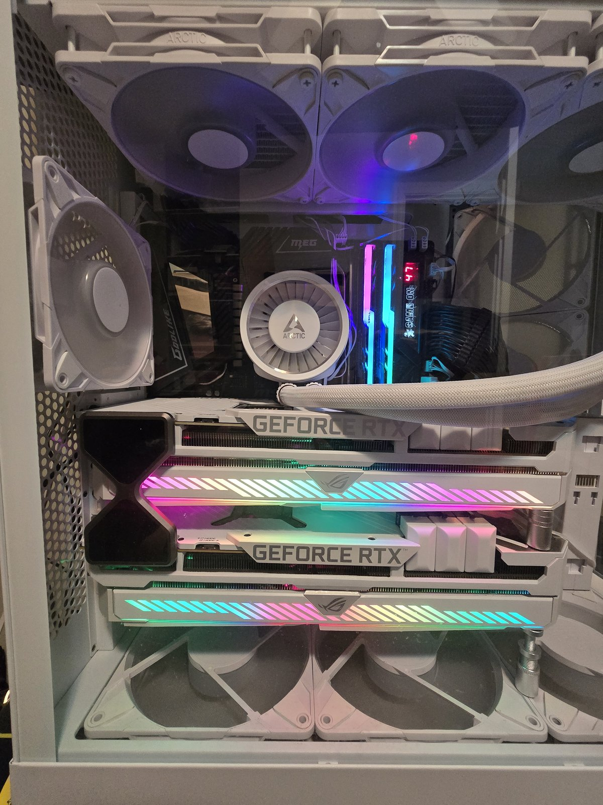

# Dual-3090 LLM Inference Server

A bare-metal, self-hosted LLM inference server built on a dual-CCD AMD Ryzen 9 5950X
and two NVLink-bridged RTX 3090s — documented down to the interrupt level.

Most self-hosting guides stop at `docker run`. The interesting problems on this
class of machine are not in the container: they are in how the Linux host
schedules threads across two Core Complex Dies, where hardware interrupts land,
and how much power the whole thing is allowed to pull before the UPS gives up.
This repository documents that layer, with the working configuration and the
measurements behind it.

It also documents what **didn't** work. The optimizations here were audited
against the running machine before publication, and several of them turned out
to be inactive, misconfigured, or aimed at the wrong target.
[`docs/AUDIT.md`](docs/AUDIT.md) is the honest version, and it is probably the
most useful file here.

---

## Contents

| | |
|---|---|
| [Hardware](#hardware) | What the box is |
| [`docs/cpu-topology.md`](docs/cpu-topology.md) | Dual-CCD thread placement, and how to derive it yourself |
| [`docs/irq-pinning.md`](docs/irq-pinning.md) | Interrupt isolation — including why the obvious target is the wrong one |
| [`docs/inference.md`](docs/inference.md) | llama-swap + llamAmpere / ik_llama, NVLink, measured throughput by context |
| [`docs/monitoring.md`](docs/monitoring.md) | Prometheus / Grafana / DCGM / SNMP |
| [`docs/kalshi-research.md`](docs/kalshi-research.md) | **Project: an LLM agent researching Kalshi prediction markets (paper only), and what it learned** |
| [`docs/backups.md`](docs/backups.md) | Borg file-level + Veeam image-level, with off-machine copies (Google Drive, a second machine's RAID) |
| [`docs/rag-embeddings.md`](docs/rag-embeddings.md) | Moving Open WebUI RAG to EmbeddingGemma: migration, rollback, and why the reranker went ([test](docs/reranker-test/README.md)) |
| [`docs/veeam-linux-repository.md`](docs/veeam-linux-repository.md) | Using the Linux box as a Veeam repository, and why the SMB workaround costs you |
| [`docs/AUDIT.md`](docs/AUDIT.md) | **Findings from auditing this setup against the live machine** |
| [`scripts/`](scripts/) | Host scripts (patched — see AUDIT) |
| [`llamampere/`](llamampere/README.md) | Pinned llamAmpere build + local patches for the main model |
| [`qwen-queue/`](qwen-queue/README.md) | Idle-only background queue for Qwen jobs |
| [`drivers/ixgbe-sfp/`](drivers/ixgbe-sfp/) | Setup + rollback for the M.2 Intel 82599 10GbE SFP+ card |
| [`systemd/`](systemd/) | Units for the above |
| [`docker/`](docker/) | Compose files for the whole stack, secrets parameterized |
| [`veeam/`](veeam/) | Guest pre-freeze / post-thaw scripts (patched) |
| [`grafana/`](grafana/) | Exported alert rules — Grafana owns alerting here |

---

## Hardware

<p align="center"></p>

| Component | Part |
|---|---|
| CPU | AMD Ryzen 9 5950X — 16C/32T, two CCDs, 32MB L3 per CCD |
| GPUs | 2x ASUS ROG Strix RTX 3090, NVLink bridged (4 links, ~14 GB/s each) |
| Memory | 64GB DDR4-3600 (G.SKILL Trident Z) |
| Motherboard | MSI MEG X570 GODLIKE |
| Cooling | Arctic Liquid Freezer III Pro 420, GPUs repasted |
| PSU | Corsair HX1500i (ATX 3.1) |
| UPS | CyberPower OL1500RTXL2U, RMCARD205 management card |
| Networking | Intel 82599 10GbE SFP+ (`ixgbe`) on an M.2 M-key adapter card in the chipset M.2 slot (PCIe 2.0 x4, 5 GT/s), 10GBASE-T copper SFP+ module (fiber planned), linked at 10000 Mb/s; 9.3-9.46 Gb/s iperf3. Onboard Killer E3000 2.5GbE kept as fallback |
| Chassis | NZXT H9 Flow (2025) |
| OS | Ubuntu 24.04.4 LTS, kernel 6.8.0-147-generic (GA kernel, not HWE) |

> **No expansion slots remain.** Two triple-slot ROG Strix 3090s bridged with
> NVLink physically occupy everything, and AM4 only has 16 CPU PCIe lanes to
> begin with — both cards run at **x8** (`current_link_width: 8`, max 16) once
> the second slot is populated. The 10GbE NIC therefore lives in an **M.2 slot**:
> an Intel 82599 SFP+ card on an M.2 M-key adapter, in the chipset-attached M.2
> slot (PCIe 2.0 x4 is ~16 Gb/s, enough for one 10G port). The card sits outside
> the case on a short M.2 extension cable and takes SATA power. `ixgbe` needs
> `allow_unsupported_sfp=1` for third-party modules. Measured 9.3-9.46 Gb/s with
> iperf3 and 18.4 Gb/s bidirectional, no drops.
>
> A USB-C 5GbE adapter (Realtek RTL8157) came first and was retired: under
> sustained two-way load it hung with carrier up and no traffic, on both the
> stock `cdc_ncm` driver and Realtek's `r8152` DKMS driver.
>
> **Link flaps, 2026-10-26.** Two separate faults on the copper path: a Cat6
> keystone coupler caused CRC errors (proven), and one brand of 10GBASE-T SFP+
> module dropped the link repeatedly (likely; a different model has had no
> drops since). Planned: OM4 fiber with 10GBASE-SR modules. A Grafana alert
> fires on more than 5 link drops in 10 minutes. The NIC's 32 queue interrupts
> all land on CCD1 (8-15, 24-31).
>
> If you are planning a similar build and want 10GbE with both PCIe slots full,
> an M.2 NIC costs you one NVMe slot and works.

---

## The core idea

The 5950X is two 8-core dies that do not share L3 cache. Anything crossing
between them pays a latency penalty through the I/O die. So the machine is
partitioned along that physical boundary and nothing is allowed to drift across
it:

```
CCD0 — cores 0-7  (L3 pool #0)        CCD1 — cores 8-15 (L3 pool #1)
├─ 0    kernel housekeeping (+SMT 16) └─ 8-15 everything else (+SMT 24-31)
├─ 1-2  inference  (+SMT 17-18)          postgres, qdrant, embeddings,
├─ 3-4  unassigned (+SMT 19-20)          tika, agents, monitoring, voice
├─ 5-6  web UI + light services (+SMT 21-22)
└─ 7    GPU interrupts (+SMT 23)
```

Inference gets two whole physical cores (both SMT threads) and an uncontended slice of L3. The RAG
stack — vector search, chunking, database writes, document parsing — is
cache-hostile and I/O-heavy by nature, so it is exiled to the other die where
it can thrash as hard as it likes without evicting a single line of the
inference working set.

This is enforced with `cpuset` in Compose, verifiable at any time:

```bash
docker inspect -f '{{.Name}} {{.HostConfig.CpusetCpus}}' $(docker ps -q)
```

> **The SMT trap.** On this CPU the sibling of core *N* is thread *N+16*, not
> *N+1*. `cpuset: "0-4"` gives you five *logical* CPUs — one thread on each of
> five physical cores, with the siblings (16-20) left to the host. All ten are
> `"0-4,16-20"`. This repo once mislabeled `"0-4"` as the latter; see
> [AUDIT #2](docs/AUDIT.md). Since 2026-10-26 the engine runs on `"1-2,17-18"`:
> two whole cores, skipping core 0 (kernel housekeeping). With the model fully
> on the GPUs, generation keeps exactly one core busy, and an A/B against five
> cores found no difference.

---

## Inference

`llama-swap` is the router: it exposes one OpenAI-compatible endpoint, launches
the right backend process on demand, and unloads it after a TTL. The main model
runs on [llamAmpere](llamampere/README.md), a llama.cpp fork with Ampere-specific
attention kernels, built here with five local patches; every other model runs on
`ik-llama-server`, which ships in the llama-swap image and remains a one-edit
fallback for the main model.

Both cards are driven with tensor parallelism (`--split-mode tensor`) over the
NVLink bridge, pooling 48GB of VRAM so a 27B dense model at Q8 fits with a
262k context.

Measured on this machine, Qwen3.8-27B at Q8_0 with MTP speculative decoding,
from the llama-swap request log over six days of real use (2026-10-20 to 10-26,
472 requests with at least 16 output tokens):

| Context | Generation, median | 1 in 10 requests above | Requests | Previous ik_llama setup |
|---|---|---|---|---|
| 0-8k | **98 tok/s** | 119 | 261 | |
| 8-32k | **106 tok/s** | 131 | 130 | 43-48 (33k) |
| 32-64k | **100 tok/s** | 118 | 24 | |
| 64-128k | **91 tok/s** | 112 | 38 | 35 (108k) |
| 128k+ | **93 tok/s** | 112 | 19 | 24-31 (184-240k) |

Medians are read from a histogram with 90/100/120 tok/s bucket edges, so they
are good to about ±5 tok/s. A replayed-request benchmark of the same build
(2026-10-19) gives 101.5 tok/s at 33k, 92.1 at 108k and 103.1 at 33k with tools.

Prompt processing: ~1,700 tok/s at 33k, ~1,040 tok/s at 184k.

See [`docs/inference.md`](docs/inference.md) for the full configuration.

---

## Service stack

All of it is in [`docker/`](docker/), secrets parameterized, one directory per unit.

- **Frontend** — Open WebUI (CCD0, next to the engine)
- **Data** — PostgreSQL (chat history), Qdrant (vectors)
- **RAG** — EmbeddingGemma-300m Q8 on llama.cpp (`gemma-embed`, CPU, since 2026-10-05; replaced
  Infinity/nomic), Apache Tika 4 extraction (pinned). The GPU reranker (bge-reranker-v2-m3) was removed: it
  lowered nDCG@10 by ~4 points against no reranker ([test](docs/reranker-test/README.md)); hybrid search is off
- **Ingress** — `cloudflared` Zero Trust tunnel, no inbound ports opened
- **Observability** — Prometheus, Grafana, node-exporter, dcgm-exporter,
  snmp-exporter, smartctl-exporter (NVMe SMART), plus a small custom exporter for llama-swap tokens/sec
- **Backups** — two layers: Borg nightly with Postgres/Qdrant pre-hooks, plus
  Veeam image-level backup with guest freeze/thaw scripts; the Borg repository is
  synced to Google Drive nightly and Veeam copies to a RAID on another machine
- **Background Qwen work** — [`qwen-queue/`](qwen-queue/): one job at a time, only when the main model is
  loaded and idle, with an hourly budget
- **GPU cooling** — a VRAM-driven fan curve (`scripts/gpu-fan-curve.py`) on 2 s temperature sampling, because
  the stacked cards' memory runs far hotter than the core the driver's curve follows (see docs/monitoring.md)
- **Home Assistant voice** — [`docker/wyoming/`](docker/wyoming/): Qwen3-ASR speech-to-text on CPU and Qwen3-TTS
  text-to-speech, with the local Qwen model as the conversation agent

---

## Power

Two 3090s at their stock 480W ceiling is ~960W of GPU alone, which a 1500VA
UPS will not enjoy. Both cards are capped to **270W** via `nvidia-smi`, which
costs only a few percent on memory-bandwidth-bound inference and removes ~420W
of transient draw.

The UPS reports its own rated capacity as 1350W. Measured draw at idle with
models unloaded is 163W (12% load), leaving comfortable headroom under load.

> The commonly repeated "1350W limit enforced via nvidia-smi" is a conflation of
> two different numbers: 1350W is the UPS's rated output, and the `nvidia-smi`
> cap is 270W per card. Nothing enforces a system-wide wattage ceiling.

---

## Not published: the remote agent dashboard

This box also runs coding agents (Claude Code, Codex, Gemini/Antigravity) in terminal sessions, and we wrote a
private web dashboard and Android app to drive them from a phone or another machine. It lists live sessions and
their state, streams a session's terminal, sends prompts and keys, starts and resumes sessions under different
accounts, shows transcripts and file diffs, takes file uploads, and pushes notifications when an agent needs
input. It runs on a patched [clauth](https://github.com/uwuclxdy/clauth) daemon and [herdr](https://herdr.dev).

It is not in this repository on purpose. It is a remote-control surface for the machine, and as written it
is tied to this network, its authentication, mounts and accounts, so publishing it as-is would invite unsafe
copy-paste installs. A generic version, with safe defaults, TLS and authentication by design, and its own
threat model and security review, may follow later as a separate project.

---

## Using this

Nothing here is a turnkey installer, and you should not run it as one — the
core pinning values are specific to a 16-core dual-CCD Ryzen. Read
[`docs/cpu-topology.md`](docs/cpu-topology.md) first and derive your own layout
from `lscpu -e=CPU,CORE,CACHE`.

```bash
git clone https://github.com/<you>/dual-3090-llm-server
cd dual-3090-llm-server

# Host scripts
sudo install -m 0755 scripts/*.sh /usr/local/bin/
sudo install -m 0644 systemd/* /etc/systemd/system/
sudo systemctl daemon-reload
sudo systemctl enable --now optimize-ai.service optimize-ai.timer nvidia-power-limit.service

# Shared container network
docker network create ai-net

# Per-service: copy .env.example to .env and fill it in first
cd docker/open-webui && cp .env.example .env && $EDITOR .env && docker compose up -d
```

**Every `.env.example` needs real values before anything will start.** No
credentials are committed to this repository, and `.gitignore` is set up to
keep it that way.

---

## Contributing

Corrections are especially welcome. If something here is wrong — and given the
audit results, more of it may be — open an issue. Measurements beat reasoning
about cache hierarchies, and a counter-example with `perf` output will always
win the argument.

## License

MIT — see [LICENSE](LICENSE).
